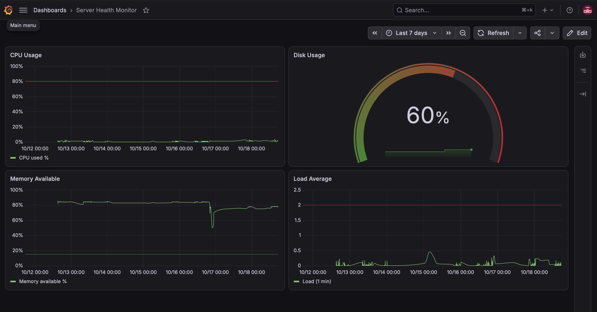

# Server Health Monitor

An automated monitoring pipeline for a Linux server: bash scripts collect system metrics on a schedule, load them into PostgreSQL, check them against alert thresholds, and visualize them in a Grafana dashboard.



## How it works

```
cron (every 5 min)
   │
   ├─▶ collect_metrics.sh   → reads CPU, memory, swap, disk, load → appends to CSV
   ├─▶ load_metrics.sh      → loads new rows into PostgreSQL (skips duplicates)
   └─▶ check_alerts.sh      → compares latest reading to thresholds → alerts.log
                                         │
                              PostgreSQL ◀── Grafana dashboard (read-only user)
```

## Features

- **Automated collection:** a bash script reads metrics from `vmstat`, `free`, `df`, and `/proc/loadavg`, scheduled with cron every 5 minutes
- **Idempotent loading:** CSV data lands in a staging table, then is inserted with `ON CONFLICT DO NOTHING`, so re-running the loader never creates duplicates
- **Threshold alerts:** warnings are logged when CPU > 80%, memory available < 15%, disk > 85%, or swap > 500 MB (thresholds configurable via environment variables)
- **Grafana dashboard:** CPU, memory, disk, and load panels, each with its alert threshold drawn on the chart
- **Least-privilege access:** Grafana connects with a dedicated read-only PostgreSQL role
- **Logging:** every scheduled run writes its output and errors to a log file

## Tech stack

Linux (Ubuntu Server) · Bash · cron · PostgreSQL · SQL · Grafana · Git

## Project structure

```
server-health-monitor/
├── scripts/
│   ├── collect_metrics.sh   # collects metrics and appends to CSV
│   ├── load_metrics.sh      # loads CSV into PostgreSQL
│   └── check_alerts.sh      # checks thresholds and logs warnings
├── sql/
│   └── create_table.sql     # table schema
├── grafana/
│   └── dashboard.json       # exported Grafana dashboard
└── docs/
    └── dashboard.png        # dashboard screenshot
```

`data/` and `logs/` are created automatically at runtime and are excluded from Git.

## Setup

1. **Clone the repo and make the scripts executable**
```bash
   git clone git@github.com:chandralekharavikanti/server-health-monitor.git
   cd server-health-monitor
   chmod +x scripts/*.sh
```

2. **Set up PostgreSQL**
```bash
   sudo apt install -y postgresql
   sudo -u postgres createuser $USER
   sudo -u postgres createdb -O $USER server_health
   psql server_health -f sql/create_table.sql
```

3. **Schedule the pipeline with cron** (`crontab -e`), replacing the path with your own:
```
   */5 * * * * (/path/to/scripts/collect_metrics.sh && /path/to/scripts/load_metrics.sh && /path/to/scripts/check_alerts.sh) >> /path/to/logs/cron.log 2>&1
```

4. **Set up Grafana**
   - Install Grafana and add PostgreSQL as a data source (ideally with a read-only user)
   - Import `grafana/dashboard.json` via **Dashboards → New → Import**

## What the data showed

Over a week of collection, the dashboard captured real changes on the server. Installing Grafana itself raised disk usage from about 45% to 60% and reduced available memory from about 85% to 75%. Gaps in the charts show periods when the VM was powered off.

## Possible improvements

- Send alerts to email or Slack instead of a log file
- Monitor multiple servers by adding a host filter to the dashboard
- Add log rotation for the CSV and log files
- Containerize the setup with Docker
